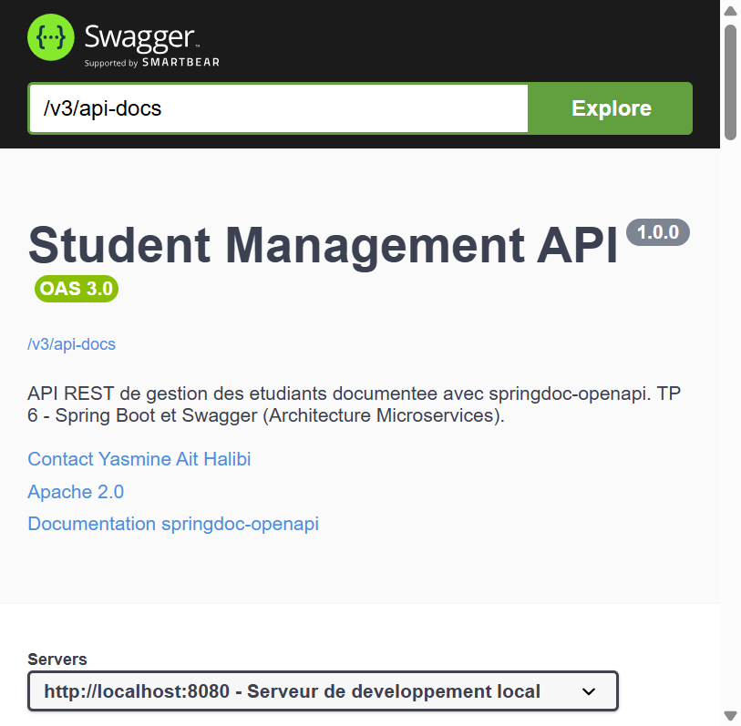

# TP 6 — Spring Boot et Swagger (Cours 7 : Architecture Microservices)

Projet **Spring Boot 3.3.5** répondant au TP 6 du cours 7
(« Architecture Microservices : Conception, Déploiement et Orchestration ») :
une API REST de gestion d'étudiants, persistée dans MySQL/MariaDB, **testée** et
**documentée automatiquement** avec springdoc-openapi / Swagger UI.

| Élément | Valeur |
|---|---|
| Projet Maven | `com.example:student-management:1.0.0` |
| Spring Boot | 3.3.5 (parent) |
| Java | 17 |
| Base de données | `studentdb` (MySQL/MariaDB) |
| Documentation d'API | springdoc-openapi 2.5.0 (OpenAPI 3.0.1) |
| Tests | **41 tests JUnit 5 / Mockito / MockMvc — 41 ✅** |

* Swagger UI : <http://localhost:8080/swagger-ui.html>
* Contrat OpenAPI JSON : <http://localhost:8080/v3/api-docs>
* Endpoints métier : <http://localhost:8080/students/...>
* Exposition Spring Data REST : <http://localhost:8080/api/students-data>

---

## Sommaire

1. [Environnement et prérequis](#1-environnement-et-prérequis)
2. [Le « magie » de Spring Boot](#2-le-magie-de-spring-boot)
3. [Architecture du projet](#3-architecture-du-projet)
4. [Les 9 étapes du TP](#4-les-9-étapes-du-tp)
5. [Dépendances du `pom.xml`](#5-dépendances-du-pomxml)
6. [Les endpoints REST](#6-les-endpoints-rest)
7. [Tests automatisés (41 tests)](#7-tests-automatisés-41-tests)
8. [Documentation Swagger / OpenAPI](#8-documentation-swagger--openapi)
9. [Résultats d'exécution réels](#9-résultats-dexécution-réels)
10. [Choix techniques et points d'attention](#10-choix-techniques-et-points-dattention)

---

## 1. Environnement et prérequis

| Élément | Version utilisée |
|---|---|
| JDK | 17 (`java.version = 17`) |
| Maven | Apache Maven 3.9+ |
| Spring Boot | 3.3.5 |
| springdoc-openapi | 2.5.0 (`springdoc-openapi-starter-webmvc-ui`) |
| Driver JDBC | `com.mysql:mysql-connector-j` (géré par le parent) |
| Base de données | MariaDB 10.4.32 (XAMPP) sur `localhost:3306` |
| Tests | JUnit 5, Mockito, AssertJ, MockMvc (via `spring-boot-starter-test`) |

La base doit être accessible avec l'utilisateur `root` et un mot de passe vide
(modifiable dans [`application.properties`](./src/main/resources/application.properties)).

Elle est **créée automatiquement** au premier lancement grâce à
`createDatabaseIfNotExist=true` dans l'URL JDBC et à `spring.jpa.hibernate.ddl-auto=update`.

### Commandes

```bash
# Compilation
mvn clean compile

# Tests (les 41 tests, dont 9 sur une vraie base MariaDB)
mvn clean test

# Packaging (jar exécutable)
mvn clean package

# Exécution
java -jar target/student-management-1.0.0.jar
# ou
mvn spring-boot:run
```

Puis ouvrir <http://localhost:8080/swagger-ui.html>.

---

## 2. Le « magie » de Spring Boot

L'énoncé insiste sur le fait que Spring Boot supprime la configuration XML :

| Configuration « Spring classique » | Remplacé par |
|---|---|
| `web.xml` + `DispatcherServlet` déclaré à la main | `spring-boot-starter-web` + Tomcat embarqué |
| `applicationContext.xml` + `<bean>` | scan automatique des `@Component`, `@Service`, `@RestController`, `@Repository` |
| `persistence.xml` + `LocalContainerEntityManagerFactoryBean` | `spring-boot-starter-data-jpa` + `spring.datasource.*` |
| `hibernate.cfg.xml` (dialecte, `hbm2ddl`) | `spring.jpa.*` (dialecte **auto-détecté**) |
| Déploiement d'un WAR dans un serveur externe | `java -jar` : le serveur est **dans** le jar |

Conséquence concrète : la classe
[`StudentManagementApplication`](./src/main/java/com/example/studentmanagement/StudentManagementApplication.java)
tient en une annotation et une méthode `main` :

```java
@SpringBootApplication
public class StudentManagementApplication {
    public static void main(String[] args) {
        SpringApplication.run(StudentManagementApplication.class, args);
    }
}
```

---

## 3. Architecture du projet

```
lab6Microservice/
├── pom.xml
├── README.md
├── docs/                                       # preuves d'exécution
│   ├── build-tests.log                         # mvn test : 41/41
│   ├── startup.log                             # démarrage + DDL Hibernate
│   ├── endpoints-demo.log                       # tous les endpoints en HTTP réel
│   ├── openapi-v3-api-docs.json                 # contrat OpenAPI complet
│   ├── openapi-summary.log                      # résumé lisible du contrat
│   └── images/swagger-ui.png                    # capture de Swagger UI
└── src/
    ├── main/
    │   ├── java/com/example/studentmanagement/
    │   │   ├── StudentManagementApplication.java
    │   │   ├── entity/Student.java               # @Entity → table student
    │   │   ├── repository/StudentRepository.java # Spring Data JPA + Data REST
    │   │   ├── service/StudentService.java       # logique métier
    │   │   ├── controller/StudentController.java # 9 endpoints REST
    │   │   ├── dto/StudentStatistics.java        # objet de réponse agrégé
    │   │   ├── config/OpenApiConfig.java         # métadonnées Swagger
    │   │   └── exception/                        # 404 / 400 en JSON
    │   └── resources/application.properties
    └── test/java/com/example/studentmanagement/
        ├── controller/StudentControllerTest.java          # 11 tests Mockito
        ├── controller/StudentControllerMockMvcTest.java   # 11 tests MockMvc
        ├── service/StudentServiceTest.java                # 10 tests Mockito
        └── repository/StudentRepositoryTest.java          # 9 tests @DataJpaTest
```

Chaque couche ne connaît que la suivante :

```
HTTP  →  StudentController  →  StudentService  →  StudentRepository  →  MySQL (table student)
          (REST, @Valid)        (métier, @Transactional)  (JpaRepository, JPQL)
```

---

## 4. Les 9 étapes du TP

| Étape de l'énoncé | Demande | Implémentation |
|---|---|---|
| 1 | Créer le projet sur Spring Initializr | [`pom.xml`](./pom.xml) avec le parent `spring-boot-starter-parent` 3.3.5, Java 17, starters Web / Data JPA / Data REST / Validation / DevTools, driver MySQL |
| 2 | Vérifier / adapter le `pom.xml` | dépendances ci-dessus + `springdoc-openapi-starter-webmvc-ui` et `spring-boot-maven-plugin` (devtools exclu du jar) |
| 3 | Configurer MySQL | [`application.properties`](./src/main/resources/application.properties) : URL JDBC `studentdb`, `root`, `ddl-auto=update`, `show-sql=true` |
| 4 | Entité + Repository | [`Student`](./src/main/java/com/example/studentmanagement/entity/Student.java) (`@Entity`, `@Table(name="student")`) + [`StudentRepository`](./src/main/java/com/example/studentmanagement/repository/StudentRepository.java) (`extends JpaRepository`) |
| 5 | Services + Contrôleurs REST | [`StudentService`](./src/main/java/com/example/studentmanagement/service/StudentService.java) + [`StudentController`](./src/main/java/com/example/studentmanagement/controller/StudentController.java) (`/students/save`, `/count`, `/delete/{id}`, …) |
| 6 | Lancer l'application | `java -jar target/student-management-1.0.0.jar` → Tomcat 8080, table `student` créée par Hibernate ([`docs/startup.log`](./docs/startup.log)) |
| 7 | Tester les endpoints | `POST /students/save`, `GET /students/all`, `/count`, `/byYear`, `DELETE /students/delete/{id}` — codes **201 / 200 / 204 / 404** conformes ([`docs/endpoints-demo.log`](./docs/endpoints-demo.log)) |
| 8 | Tests JUnit 5 + Mockito | 41 tests : contrôleur (Mockito + MockMvc), service (Mockito), repository (`@DataJpaTest` sur MariaDB) |
| 9 | Swagger / OpenAPI | `OpenApiConfig` (Info, Contact, License, Server) + `@Tag` / `@Operation` / `@ApiResponse` / `@Schema` + Swagger UI |

### Étape 4 — l'entité `Student`

```java
@Entity
@Table(name = "student")
@Schema(description = "Etudiant enregistre en base (table student)")
public class Student {

    @Id
    @GeneratedValue(strategy = GenerationType.IDENTITY)
    private int id;

    @NotBlank(message = "Le nom est obligatoire")
    private String nom;

    @NotBlank(message = "Le prenom est obligatoire")
    private String prenom;

    @Temporal(TemporalType.DATE)
    @Past(message = "La date de naissance doit etre dans le passe")
    @JsonFormat(pattern = "yyyy-MM-dd", timezone = "Europe/Paris")
    private Date dateNaissance;

    // constructeurs (dont un sans id), getters/setters, equals/hashCode, toString
}
```

### Étape 4 — le repository

```java
@Repository
@RepositoryRestResource(path = "students-data", collectionResourceRel = "students", exported = true)
public interface StudentRepository extends JpaRepository<Student, Integer> {

    Student findById(int id);                       // signature exacte de l'énoncé

    Optional<Student> findStudentById(int id);      // variante null-safe pour le service
    List<Student> findByNomIgnoreCase(String nom);  // requête dérivée du nom de méthode
    boolean existsByNomIgnoreCaseAndPrenomIgnoreCase(String nom, String prenom);

    @Query("SELECT YEAR(s.dateNaissance), COUNT(s) FROM Student s "
         + "GROUP BY YEAR(s.dateNaissance) ORDER BY YEAR(s.dateNaissance)")
    Collection<Object[]> findNbrStudentByYear();    // [[1985,2],[1990,1]]

    @Query("SELECT s FROM Student s WHERE YEAR(s.dateNaissance) > :annee ORDER BY s.dateNaissance")
    List<Student> findStudentsBornAfter(@Param("annee") int annee);
}
```

### Étape 5 — le service

```java
@Service
@Transactional(readOnly = true)
public class StudentService {

    private final StudentRepository studentRepository;

    public StudentService(StudentRepository studentRepository) {   // injection par constructeur
        this.studentRepository = studentRepository;
    }

    @Transactional
    public Student save(Student student) {
        return studentRepository.save(student);      // insert ou update selon l'id
    }

    @Transactional
    public boolean delete(int id) {
        Optional<Student> studentOptional = Optional.ofNullable(studentRepository.findById(id));
        if (studentOptional.isPresent()) {
            studentRepository.delete(studentOptional.get());
            return true;                             // → 204 No Content
        }
        return false;                                // → 404 Not Found
    }

    public long countStudents() { return studentRepository.count(); }

    public Student findById(int id) {
        Student student = studentRepository.findById(id);
        if (student == null) {
            throw new ResourceNotFoundException("Aucun etudiant avec l'id " + id);
        }
        return student;
    }

    // findAll, findNbrStudentByYear, findByNom, findStudentsBornAfter
}
```

### Étape 5 — le contrôleur (extrait)

```java
@RestController
@RequestMapping("/students")
@Tag(name = "Etudiants", description = "Gestion des etudiants (CRUD, comptage, statistiques par annee)")
public class StudentController {

    @Operation(summary = "Enregistrer un etudiant")
    @ApiResponses({
        @ApiResponse(responseCode = "201", description = "Etudiant enregistre"),
        @ApiResponse(responseCode = "400", description = "Donnees invalides")
    })
    @PostMapping("/save")
    public ResponseEntity<Student> save(@Valid @RequestBody Student student) {
        return new ResponseEntity<>(studentService.save(student), HttpStatus.CREATED);
    }

    @Operation(summary = "Supprimer un etudiant par identifiant")
    @ApiResponses({
        @ApiResponse(responseCode = "204", description = "Etudiant supprime"),
        @ApiResponse(responseCode = "404", description = "Etudiant inexistant")
    })
    @DeleteMapping("/delete/{id}")
    public ResponseEntity<Void> delete(@PathVariable("id") int id) {
        return studentService.delete(id)
                ? new ResponseEntity<>(HttpStatus.NO_CONTENT)
                : new ResponseEntity<>(HttpStatus.NOT_FOUND);
    }

    @GetMapping("/count")
    public ResponseEntity<Long> countStudent() { ... }
}
```

---

## 5. Dépendances du `pom.xml`

| Dépendance | Rôle |
|---|---|
| `spring-boot-starter-parent` 3.3.5 | versions cohérentes de tous les starters |
| `spring-boot-starter-web` | Spring MVC + Tomcat embarqué + Jackson |
| `spring-boot-starter-data-jpa` | Hibernate 6 + Spring Data JPA |
| `spring-boot-starter-data-rest` | exposition automatique du repository en HAL |
| `spring-boot-starter-validation` | `@Valid`, `@NotBlank`, `@Past` (Jakarta Validation) |
| `spring-boot-devtools` | redémarrage automatique en développement |
| `com.mysql:mysql-connector-j` | driver JDBC MySQL/MariaDB |
| `springdoc-openapi-starter-webmvc-ui` 2.5.0 | contrat OpenAPI 3 + Swagger UI |
| `spring-boot-starter-test` | JUnit 5, Mockito, AssertJ, MockMvc, JSONPath |
| `spring-boot-maven-plugin` | jar exécutable (`repackage`) |

---

## 6. Les endpoints REST

| Méthode | URL | Réponse | Description |
|---|---|---|---|
| `POST` | `/students/save` | **201** / 400 | Enregistrer (ou mettre à jour) un étudiant |
| `GET` | `/students/all` | **200** | Liste complète |
| `GET` | `/students/count` | **200** | Nombre total (`3`) |
| `GET` | `/students/byYear` | **200** | Nombre par année de naissance (`[[1985,2],[1990,1]]`) |
| `GET` | `/students/{id}` | **200** / 404 | Un étudiant par identifiant |
| `GET` | `/students/search?nom=` | **200** | Recherche par nom (insensible à la casse) |
| `GET` | `/students/bornAfter?annee=` | **200** | Étudiants nés après une année |
| `GET` | `/students/statistics` | **200** | Total + répartition (`{"total":3,"parAnnee":{"1985":2,"1990":1}}`) |
| `DELETE` | `/students/delete/{id}` | **204** / 404 | Suppression |

Exemples :

```bash
# Créer
curl -i -X POST http://localhost:8080/students/save \
     -H "Content-Type: application/json" \
     -d '{"nom":"LACHGAR","prenom":"Mohamed","dateNaissance":"1985-09-01"}'
# HTTP/1.1 201
# {"id":1,"nom":"LACHGAR","prenom":"Mohamed","dateNaissance":"1985-09-01"}

# Compter / répartition par année
curl http://localhost:8080/students/count      # 3
curl http://localhost:8080/students/byYear     # [[1985,2],[1990,1]]

# Supprimer
curl -i -X DELETE http://localhost:8080/students/delete/3   # 204
curl -i -X DELETE http://localhost:8080/students/delete/999 # 404
```

### Gestion des erreurs

[`GlobalExceptionHandler`](./src/main/java/com/example/studentmanagement/exception/GlobalExceptionHandler.java)
traduit les exceptions en JSON :

```json
// GET /students/999  →  404
{"horodatage":"...","statut":404,"erreur":"Not Found","message":"Aucun etudiant avec l'id 999"}

// POST /students/save avec nom vide  →  400
{"horodatage":"...","statut":400,"erreur":"Bad Request","message":"Validation echouee",
 "erreurs":{"nom":"Le nom est obligatoire"}}
```

### Bonus : exposition Spring Data REST

Le starter `spring-boot-starter-data-rest` expose aussi le repository, sans écrire de contrôleur,
sous `/api/students-data` (HAL + profil ALPS) :

```bash
curl http://localhost:8080/api/students-data
# {"_embedded":{"students":[{...}]},"_links":{...},"page":{"size":20,"totalElements":2,...}}
```

`spring.data.rest.detection-strategy=annotated` limite cette exposition aux repositories annotés
`@RepositoryRestResource` et évite le conflit d'URL avec `/students`.

---

## 7. Tests automatisés (41 tests)

`mvn clean test` exécute **41 tests JUnit 5**, tous verts.

| Classe de test | Type | Tests | Résultat |
|---|---|---|---|
| `StudentControllerTest` | unitaire — Mockito | 11 | ✅ |
| `StudentControllerMockMvcTest` | `@WebMvcTest` — MockMvc (URL, codes HTTP, JSONPath) | 11 | ✅ |
| `StudentServiceTest` | unitaire — Mockito (repository mocké) | 10 | ✅ |
| `StudentRepositoryTest` | `@DataJpaTest` sur la vraie base `studentdb_test` | 9 | ✅ |

```
[INFO] Tests run: 11, Failures: 0, Errors: 0, Skipped: 0 -- StudentControllerMockMvcTest
[INFO] Tests run: 11, Failures: 0, Errors: 0, Skipped: 0 -- StudentControllerTest
[INFO] Tests run:  9, Failures: 0, Errors: 0, Skipped: 0 -- StudentRepositoryTest
[INFO] Tests run: 10, Failures: 0, Errors: 0, Skipped: 0 -- StudentServiceTest
[INFO] Tests run: 41, Failures: 0, Errors: 0, Skipped: 0
[INFO] BUILD SUCCESS
```

Ce que vérifient les tests :

* **Contrôleur (MockMvc)** : `POST /students/save` → 201, `GET /students/all` → 200,
  `GET /students/count` → `"3"`, `GET /students/byYear` → `[[1985,2]]`,
  `DELETE /students/delete/1` → 204, `DELETE /students/delete/999` → 404,
  `GET /students/999` → 404, nom vide → 400 + `$.erreurs.nom`.
* **Contrôleur (Mockito)** : le service est mocké, les `ResponseEntity` et leurs statuts sont
  vérifiés, et `save` n'appelle jamais `delete` (`verify(..., never())`).
* **Service** : `delete` renvoie `true`/`false` selon la présence en base, `findById` lève
  `ResourceNotFoundException`, `save` transmet bien l'entité au repository.
* **Repository** : sur une base réelle, `save` génère l'id, `findNbrStudentByYear` renvoie
  `[[1985,2],[1990,1]]`, `findByNomIgnoreCase` ignore la casse, la suppression est effective.

La sortie complète est disponible dans [`docs/build-tests.log`](./docs/build-tests.log).

---

## 8. Documentation Swagger / OpenAPI

springdoc-openapi scanne les `@RestController` au démarrage : **aucune liste d'endpoints n'est
écrite à la main**. Le bean
[`OpenApiConfig`](./src/main/java/com/example/studentmanagement/config/OpenApiConfig.java)
n'ajoute que les métadonnées :

```java
@Bean
public OpenAPI studentManagementOpenAPI() {
    return new OpenAPI()
            .info(new Info()
                    .title("Student Management API")
                    .version("1.0.0")
                    .description("API REST de gestion des etudiants documentee avec springdoc-openapi. "
                               + "TP 6 - Spring Boot et Swagger (Architecture Microservices).")
                    .contact(new Contact().name("Yasmine Ait Halibi").email("aithalibi@example.com"))
                    .license(new License().name("Apache 2.0")
                            .url("https://www.apache.org/licenses/LICENSE-2.0.html")))
            .servers(List.of(new Server().url("http://localhost:" + port)
                    .description("Serveur de developpement local")))
            .externalDocs(new ExternalDocumentation()
                    .description("Documentation springdoc-openapi").url("https://springdoc.org/"));
}
```

| URL | Contenu |
|---|---|
| `/swagger-ui.html` | interface Swagger UI (redirige vers `/swagger-ui/index.html`) |
| `/v3/api-docs` | contrat OpenAPI 3.0.1 au format JSON |
| `/v3/api-docs.yaml` | même contrat au format YAML |



Le contrat généré contient **18 chemins** et **13 schémas** :

* 9 chemins métier (`/students/*`) décrits par `@Operation` / `@ApiResponse` / `@Parameter` ;
* 9 chemins Spring Data REST (`/api/students-data`, `/api/profile`, …).

Résumé lisible : [`docs/openapi-summary.log`](./docs/openapi-summary.log) —
contrat complet : [`docs/openapi-v3-api-docs.json`](./docs/openapi-v3-api-docs.json).

Chaque champ de l'entité est aussi documenté (`@Schema`) : type, exemple, obligatoire ou
lecture seule (l'`id` est `READ_ONLY`), ce qui produit des exemples pré-remplis dans
« Try it out ».

---

## 9. Résultats d'exécution réels

### Démarrage ([`docs/startup.log`](./docs/startup.log))

```
  .   ____          _            __ _ _
 /\\ / ___'_ __ _ _(_)_ __  __ _ \ \ \ \
( ( )\___ | '_ | '_| | '_ \/ _` | \ \ \ \
 ...
 :: Spring Boot ::                (v3.3.5)

Hibernate: create table student (id integer not null auto_increment,
    date_naissance date, nom varchar(255) not null, prenom varchar(255) not null,
    primary key (id)) engine=InnoDB
Tomcat started on port 8080 (http) with context path '/'
Started StudentManagementApplication in 13.002 seconds
```

### Scénario complet ([`docs/endpoints-demo.log`](./docs/endpoints-demo.log))

```
POST /students/save  {"nom":"LACHGAR","prenom":"Mohamed","dateNaissance":"1985-09-01"}  --> 201  {"id":1,...}
POST /students/save  {"nom":"SAFI","prenom":"Said","dateNaissance":"1985-12-24"}         --> 201  {"id":2,...}
POST /students/save  {"nom":"RAMI","prenom":"Salima","dateNaissance":"1990-06-15"}       --> 201  {"id":3,...}

GET  /students/all          --> 200  [3 etudiants]
GET  /students/count        --> 200  3
GET  /students/byYear       --> 200  [[1985,2],[1990,1]]
GET  /students/1            --> 200  {"id":1,"nom":"LACHGAR",...}
GET  /students/search?nom=LACHGAR         --> 200  [{"id":1,...}]
GET  /students/bornAfter?annee=1985       --> 200  [{"id":3,...}]
GET  /students/statistics   --> 200  {"total":3,"parAnnee":{"1985":2,"1990":1}}

DELETE /students/delete/3   --> 204
DELETE /students/delete/999 --> 404
GET  /students/count        --> 200  2

GET  /students/999          --> 404  {"statut":404,"message":"Aucun etudiant avec l'id 999"}
POST /students/save (nom="") --> 400 {"statut":400,"erreurs":{"nom":"Le nom est obligatoire"}}

GET  /api/students-data     --> 200  (_embedded.students, _links, page)
GET  /swagger-ui.html       --> 200  (redirection)
GET  /v3/api-docs           --> 200  contrat OpenAPI 3 de 14 061 caracteres, 18 chemins
```

---

## 10. Choix techniques et points d'attention

* **Fuseau horaire des dates** — `@JsonFormat(pattern = "yyyy-MM-dd")` **sans** `timezone`
  décale la date d'un jour sur une machine en `Romance Standard Time` (la date `1985-09-01`
  revenait en `1985-08-31`). Correctif : `timezone = "Europe/Paris"` sur l'annotation **et**
  `spring.jackson.time-zone=Europe/Paris`.
* **Spring Data REST change le `Content-Type`** — avec `spring-boot-starter-data-rest`,
  toutes les réponses passent en `application/hal+json`, y compris dans « Try it out » de
  Swagger UI. Correctif : `spring.data.rest.default-media-type=application/json`.
* **Collision d'URL** — par défaut Spring Data REST expose *tous* les repositories, donc
  `StudentRepository` serait publié sur `/students`, en conflit avec le contrôleur.
  Correctif : `spring.data.rest.detection-strategy=annotated` +
  `@RepositoryRestResource(path = "students-data")` → Data REST vit sous `/api/students-data`.
* **`findById(int)` de l'énoncé** — `JpaRepository.findById(Integer)` renvoie un `Optional` ;
  la signature demandée (`Student findById(int)`) est conservée en parallèle, et le service
  utilise une variante explicite `findStudentById(int)` pour rester null-safe.
* **Dialecte Hibernate** — `spring.jpa.properties.hibernate.dialect` n'est **pas** défini :
  Hibernate 6 détecte MariaDB tout seul, ce qui évite un avertissement de dépréciation.
* **`spring.jpa.open-in-view=false`** — supprime l'avertissement de `JpaBaseConfiguration` et
  force le chargement des données dans la couche service, pas dans la vue JSON.
* **Validation dans la couche web** — `@Valid` + `@RestControllerAdvice` : les erreurs de
  validation renvoient un `400` structuré (map `champ → message`) au lieu d'une trace Hibernate.
* **Tests séparés de la base de production** — `StudentRepositoryTest` utilise `studentdb_test`
  avec `ddl-auto=create-drop`, donc `mvn test` ne touche jamais les données de `studentdb`.
* **`spring-boot-devtools` exclu du jar** — évite les redémarrages automatiques en production
  (`<exclude>` dans `spring-boot-maven-plugin`).
